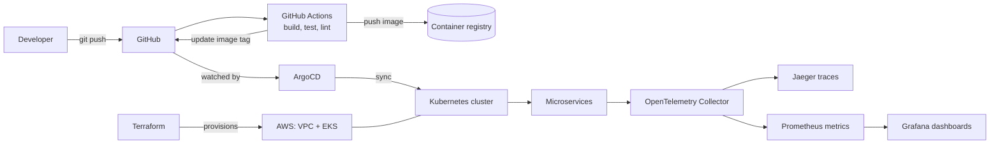

<div align="center">

# Cloud-Native Microservices Deployment

**Deploying a microservices application on Kubernetes with Docker, Terraform, GitHub Actions and ArgoCD (GitOps), observed with OpenTelemetry, Prometheus, Grafana and Jaeger.**


</div>

---

## Table of contents

- [About this repository](#about-this-repository)
- [Project status](#project-status)
- [Architecture](#architecture)
- [Tech stack](#tech-stack)
- [Repository structure](#repository-structure)
- [Run locally](#run-locally)
- [Deploy to Kubernetes](#deploy-to-kubernetes)
- [CI/CD pipeline](#cicd-pipeline)
- [GitOps with ArgoCD](#gitops-with-argocd)
- [Observability](#observability)
- [Screenshots](#screenshots)
- [What I learned](#what-i-learned)
- [Credits and license](#credits-and-license)

---

## About this repository

This is a **DevOps learning project**. The application code (the microservices in `src/`, the protobuf definitions in `pb/` and the docker-compose files) comes from the open-source [OpenTelemetry Demo](https://github.com/open-telemetry/opentelemetry-demo), which is maintained by the OpenTelemetry community and licensed under Apache-2.0.

I used it as the sample workload in a paid DevOps course, to practise deploying, automating and observing a real multi-service system. **I did not write the application.** My focus is the DevOps side: containers, Kubernetes, infrastructure as code, CI/CD and GitOps.

Original copyright and license notices are kept as required by the license.

## Project status

Work that is done and work that is still in progress, listed honestly.

- [x] Cloned the OpenTelemetry Demo and ran it locally with Docker Compose
- [x] Explored traces, metrics and dashboards (Jaeger, Grafana)
- [ ] Deploy the stack on Kubernetes using the manifests in `kubernetes/`
- [ ] GitHub Actions pipeline: build, test, lint, push images, update the manifest tag
- [ ] Terraform: AWS networking and an EKS cluster
- [ ] ArgoCD: GitOps sync from this repository
- [ ] Custom Grafana dashboards and alerts

> Tick each box only when it is actually working in this repo, and link to the folder that contains it.

## Architecture



> Replace or complement this with an exported diagram (draw.io or Excalidraw) saved as `docs/architecture.png` once your setup is final.

## Tech stack

| Area | Tools |
|---|---|
| Cloud | AWS (EKS, VPC, IAM, ECR or Docker Hub) |
| Infrastructure as Code | Terraform |
| Containers and orchestration | Docker, Kubernetes |
| CI/CD | GitHub Actions |
| GitOps | ArgoCD |
| Observability | OpenTelemetry, Prometheus, Grafana, Jaeger |
| Application (upstream) | Polyglot microservices from the OpenTelemetry Demo |

## Repository structure

```
.
├── .github/workflows/   # CI pipelines (GitHub Actions)
├── kubernetes/          # Kubernetes manifests
├── src/                 # Microservices (from the OpenTelemetry Demo)
├── pb/                  # Protobuf definitions (upstream)
├── test/                # Tests (upstream)
├── docker-compose.yml   # Local environment
├── Makefile             # Helper commands
├── terraform/           # (add) AWS infrastructure as code
├── argocd/              # (add) ArgoCD Application manifests
└── docs/                # (add) architecture diagram, screenshots
```

## Run locally

**Requirements:** Docker and Docker Compose v2.0.0 or later.

```bash
git clone https://github.com/syed-ayaan-alii/cloud-native-microservices-deployment.git
cd cloud-native-microservices-deployment
make start
```

When the containers are up:

| Service | URL |
|---|---|
| Webstore | http://localhost:8080 |
| Jaeger | http://localhost:8080/jaeger/ui/ |
| Grafana | http://localhost:8080/grafana/ |
| Load generator | http://localhost:8080/loadgen/ |

Stop everything with `make stop`.

## Deploy to Kubernetes

> Replace these with the exact commands you used.

```bash
# (optional) create a local cluster
kind create cluster --name otel-demo

# deploy the manifests
kubectl apply -f kubernetes/

# check the rollout
kubectl get pods
kubectl port-forward svc/frontend-proxy 8080:8080
```

For AWS (after the Terraform part is done):

```bash
cd terraform
terraform init
terraform plan
terraform apply
aws eks update-kubeconfig --name <cluster-name> --region <region>
```

Remember to run `terraform destroy` when you finish, to avoid AWS charges.

## CI/CD pipeline

The workflow in `.github/workflows/` runs these stages:

1. **Build and test**: compile the service and run unit tests.
2. **Code quality**: lint with `golangci-lint`.
3. **Docker**: build the image and push it to the registry, tagged with the run ID.
4. **Update manifest**: write the new image tag into the Kubernetes deployment file and commit it.

Required repository secrets (Settings → Secrets and variables → Actions):

| Secret | Purpose |
|---|---|
| `DOCKER_USERNAME` | Container registry username |
| `DOCKER_TOKEN` | Registry access token |

## GitOps with ArgoCD

ArgoCD watches this repository. When the pipeline commits a new image tag to the manifests, ArgoCD detects the change and syncs it to the cluster, so no one runs `kubectl apply` by hand.

```bash
kubectl create namespace argocd
kubectl apply -n argocd -f https://raw.githubusercontent.com/argoproj/argo-cd/stable/manifests/install.yaml
kubectl apply -f argocd/application.yaml
```

## Observability

The demo is instrumented with OpenTelemetry. Telemetry flows from each service to the OpenTelemetry Collector:

- **Traces** go to Jaeger, to follow a request across services.
- **Metrics** go to Prometheus and are visualised in Grafana.


## Credits and license

- Application and demo: the [OpenTelemetry Demo](https://github.com/open-telemetry/opentelemetry-demo) by the OpenTelemetry authors.
- Learned through a paid DevOps course. *(Add the course or instructor name if you like.)*
- Licensed under the [Apache License 2.0](./LICENSE). The original upstream contributing guide is kept as [CONTRIBUTING.md](./CONTRIBUTING.md).
